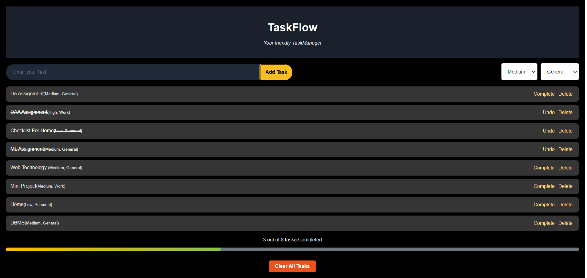

# 📋 TaskFlow

A modern and responsive **Task Management Application** built with **React**, **JavaScript**, and **Vite**. TaskFlow helps users organize daily tasks with priorities, categories, progress tracking, and persistent storage using **Local Storage**.

---
## 🌐 Live Demo

🔗**Live Demo:** https://taskflow-pink-psi-30.vercel.app/

---

## 🚀 Features

- ➕ Add new tasks
- 🗑️ Delete tasks
- ✅ Mark tasks as complete or undo completed tasks
- 🎯 Assign task priorities (High, Medium, Low)
- 📂 Organize tasks by category
- 📊 Real-time progress tracking
- 📈 Task statistics
- 💾 Local Storage support (tasks persist after refresh)
- 🧹 Clear all tasks
- 📱 Responsive and modern UI

---

## 🛠️ Tech Stack

- React
- JavaScript (ES6+)
- CSS3
- Vite
- Local Storage

---

## 📸 Screenshots



---

## ⚙️ Installation

Clone the repository

```bash
git clone https://github.com/Arsh173/taskflow.git
```

Navigate to the project folder

```bash
cd taskflow
```

Install dependencies

```bash
npm install
```

Start the development server

```bash
npm run dev
```

---

## 📂 Project Structure

```
taskflow/
│
├── public/
├── src/
│   ├── assets/
│   ├── components/
│   ├── App.jsx
│   ├── Style.css
│   ├── index.css
│   └── main.jsx
│
├── package.json
├── vite.config.js
└── README.md
```

---

## 🔮 Future Improvements

- ✏️ Edit existing tasks
- 🔍 Search tasks
- 📅 Due dates
- 🌙 Dark/Light theme toggle
- ☁️ Backend integration
- 👤 User authentication

---

## 👨‍💻 Author

**Arsh**

GitHub: https://github.com/Arsh173

---

## ⭐ Show Your Support

If you found this project helpful, consider giving it a ⭐ on GitHub!
